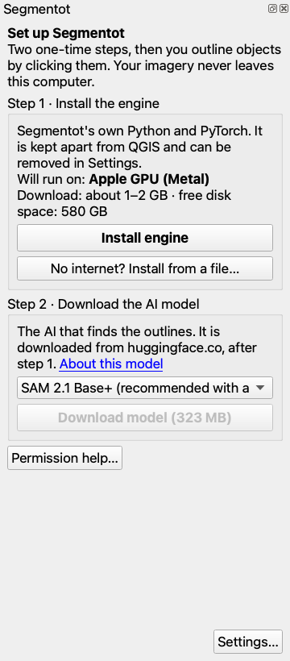
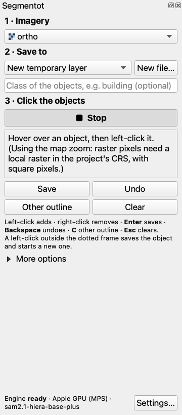
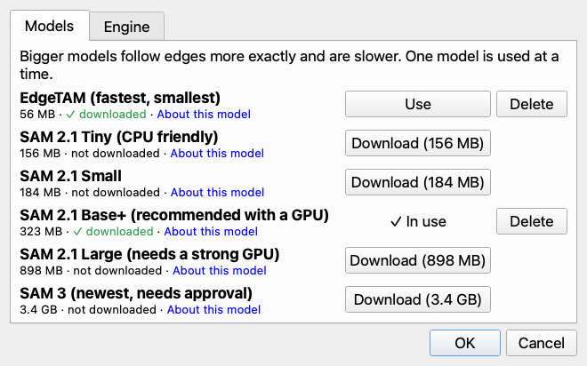

# Segmentot

Click an object on any imagery layer in QGIS and get its outline as a polygon.

Segmentot runs an AI segmentation model (SAM 2.1, EdgeTAM or SAM 3) on your own computer.
There is no account and no cloud service: your imagery never leaves the computer.

| Setup, two steps | Clicking objects | Models |
|---|---|---|
|  |  |  |

## What it does

- **Click to outline.** Left-click an object (a building, a field, a pond, a tree crown) and its outline appears.
  Right-click removes a part you do not want. Enter saves it as a polygon.
- **Works on any raster layer:** GeoTIFFs and orthophotos, and online layers (XYZ, WMS, WMTS).
- **Preview while you move the mouse**, and up to three alternative outlines for one click.
- **Clean-up options:** fill holes, square corners for buildings, smooth curves for fields and water,
  grow or shrink, simplify, drop small pieces.
- **Saves to any polygon layer**, or to a new temporary layer or GeoPackage file.
  Each object gets `class`, `score`, `area_m2` and `created` attributes.
- **Uses the GPU when there is one** (NVIDIA CUDA or Apple Metal) and falls back to the CPU by itself.

## Requirements

- QGIS 3.22 or newer.
- Windows, Linux or macOS with an Apple M-series chip. Intel Macs are not supported.
- 2 to 6 GB of free disk space for the engine, plus the model you pick (56 MB to 3.4 GB).
- Internet for the one-time setup, or an engine package file made on another computer (see below).
- A GPU is optional. Without one, each new view takes a few seconds; clicks inside a view are quick.

## Install

From the QGIS plugin manager: **Plugins → Manage and Install Plugins**, search for **Segmentot**, install.

From a zip file: **Plugins → Manage and Install Plugins → Install from ZIP**.

## First use: two steps

Click the Segmentot toolbar icon. The panel shows two one-time steps.

1. **Install the engine.** The panel shows where it will run (NVIDIA GPU, Apple GPU or CPU), the download
   size and your free disk space. Press **Install engine**. It installs its own Python and PyTorch into a
   private folder and does not change your QGIS installation.
2. **Download the AI model.** Pick a model from the list and press **Download model**.
   Nothing is downloaded until you press the button.

When both are done the panel switches to the work screen and starts the engine.

QGIS also shows a message at start-up while one of the two steps is still open.

## Using it

1. **Imagery:** choose the raster layer to click on.
2. **Save to:** choose a polygon layer, or keep *New temporary layer*, or press **New file…** for a GeoPackage.
   Optionally type a class, for example `building`.
3. Press **Start**, then click the objects on the map.

| Action | Mouse or key |
|---|---|
| Add a part to the object | Left-click |
| Remove a part | Right-click |
| Save the object | Enter |
| Undo the last point, or the last saved object | Backspace |
| Try another outline | C |
| Clear the current object | Esc |

A left-click outside the dotted frame saves the current object and starts a new one.
If an object is bigger than the dotted frame, zoom out and click it again.

**More options** holds the rest: detail (the raster's own pixels, or the current map zoom),
outline style, hover preview and the clean-up options.

## Models

Change, download or delete models in **Settings… → Models**. One model is used at a time.

| Model | Download | Notes | About |
|---|---|---|---|
| EdgeTAM | 56 MB | Fastest and smallest; slightly rougher edges | [model page](https://huggingface.co/yonigozlan/EdgeTAM-hf) |
| SAM 2.1 Tiny | 156 MB | Good on a CPU | [model page](https://huggingface.co/facebook/sam2.1-hiera-tiny) |
| SAM 2.1 Small | 184 MB | Default without a GPU | [model page](https://huggingface.co/facebook/sam2.1-hiera-small) |
| SAM 2.1 Base+ | 323 MB | Default with a GPU | [model page](https://huggingface.co/facebook/sam2.1-hiera-base-plus) |
| SAM 2.1 Large | 898 MB | Needs a strong GPU | [model page](https://huggingface.co/facebook/sam2.1-hiera-large) |
| SAM 3 | 3.4 GB | Newest; needs approval, see below | [model page](https://huggingface.co/facebook/sam3) |

Measured on an Apple M-series Mac, time to prepare a new view: EdgeTAM 0.12 s on the CPU and 0.03 s on the
GPU; SAM 2.1 Base+ 0.79 s and 0.27 s. On the test image EdgeTAM's outlines overlap the truth by 97–99%,
Base+ by 98–100%.

### SAM 3 needs approval

Meta only releases SAM 3 to Hugging Face accounts that asked for it. Pressing **Download** on SAM 3 shows
the three steps: ask for access on the model page, make an access token of type *Read*, paste the token.
The token is kept in the engine folder on your computer and is only sent to huggingface.co.

SAM 3 support is new: the download steps and the engine code are tested, the real model is not yet.

## Without internet

On a computer that has Segmentot working: **Settings… → Engine → Save engine package…**
It writes one `.tar.gz` file, with or without the downloaded models.

On the computer without internet: in step 1 press **No internet? Install from a file…** and choose that file.
Both computers must have the same operating system and processor type.
SAM 3 is never put into a package, because each computer has to ask for it itself.

## Settings

- **Models:** download, switch to, or delete a model. Delete frees its disk space.
- **Engine:** where the engine is and what it runs on, the local port, a CPU-only install,
  open the folder or the log, **Reinstall…**, **Remove…** and **Save engine package…**.

The engine folder is `~/.segmentot` on macOS and Linux and `%LOCALAPPDATA%\Segmentot` on Windows.
Set the environment variable `SEGMENTOT_HOME` to use another folder.
**Remove…** deletes only what Segmentot put there.

## Privacy

- Imagery is processed on your computer. The engine listens on `127.0.0.1` only and refuses requests
  that do not come from the plugin.
- The plugin sends imagery only to its own engine. The engine has to prove it knows a secret key kept in
  the engine folder, so another program that takes the port is refused.
- The internet is used for two things, both started by you: installing the engine
  (Python from GitHub, packages from PyPI and pytorch.org) and downloading a model (huggingface.co).
- No telemetry.

## Troubleshooting

- **The install stops with a permission error.** Press **Permission help…**. It shows ready-to-paste
  commands for your computer.
- **"Engine problem" in the panel footer.** Press *Try again*. If it stays, open
  **Settings… → Engine → Open engine log**, and try **Reinstall…**.
- **The GPU is not used.** The footer shows what the engine runs on. If the GPU failed, the engine says so
  and continues on the CPU. After a driver update, use **Reinstall…**.
- **Outlines are cut off at a straight edge.** The object is bigger than the dotted frame: zoom out.
- **Nothing is found on an online layer.** Wait until the layer has drawn, then click again.

## How it works

The plugin is small and has no Python dependencies of its own. The model runs in a separate process:

```
QGIS plugin (panel, map tool)  ──HTTP on 127.0.0.1──►  engine (private Python, PyTorch, transformers)
```

| File | Job |
|---|---|
| `gui/plugin.py` | The panel: setup steps, work screen, saving objects |
| `gui/click_tool.py` | The map tool: clicks, hover preview, keys |
| `gui/setup_ui.py` | Progress, settings, permission and access dialogs |
| `core/engine.py` | Talks to the engine, renders the image window, cleans up outlines |
| `core/runtime.py` | Installs, starts and removes the engine; downloads and deletes models |
| `core/edition.py` | Which edition this build is: auto, CPU only or GPU only |
| `server/segmentot_server.py` | The engine: loads the model and answers click requests |

`resources/` holds the icon, `docs/` the screenshots, `scripts/` the release script and `tests/` the tests.

The engine is installed with [uv](https://github.com/astral-sh/uv), pinned to one version and checked
against its published checksum.

## Development

Tests are in `tests/`; `tests/README.md` has the commands. In short:

```sh
python3 tests/test_runtime.py                      # installer logic, no QGIS needed
python tests/qt6_check.py                          # Qt6 check, needs only PyQt6
flake8 .                                           # style, 120 columns (.flake8)
bandit -r . -x ./tests                             # security scan
scripts/make_zip.sh                                # release zip next to this folder
```

Tested on macOS (Apple M-series) with QGIS 3.44 and Qt 5. The Qt 6 check passes, but the plugin has not
been run in a QGIS 4 installation yet, nor on Windows, Linux or an NVIDIA card.

## License and credits

Segmentot is free software under the GNU General Public License, version 2 or later. See `LICENSE`.

It downloads and runs, but does not include:

- [SAM 2.1](https://github.com/facebookresearch/sam2) and [EdgeTAM](https://github.com/facebookresearch/EdgeTAM)
  by Meta, Apache 2.0.
- [SAM 3](https://github.com/facebookresearch/sam3) by Meta, under Meta's own SAM license.
- [PyTorch](https://pytorch.org), [Hugging Face Transformers](https://github.com/huggingface/transformers)
  and [uv](https://github.com/astral-sh/uv).
